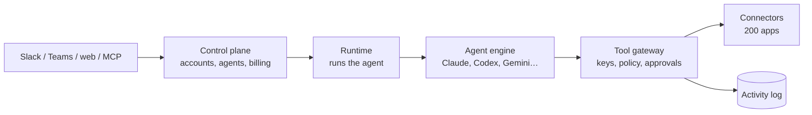

# Liftoff

[](LICENSE)

**A shared workspace where your people and AI agents work together.**

Describe a job and Liftoff builds an agent that owns it: its own tools, its own
access, and your company's context. People and agents work side by side in
shared threads, in Slack, Microsoft Teams, the web app, or from Claude Code,
Codex and Cursor. Agents work for minutes or days, stop and ask before risky
actions, and learn when someone corrects them.

Open source (Apache 2.0). Everything runs in your own Google Cloud project, on
your own credentials, and every hostname is something you configure.

▶ [Watch the demo](https://github.com/user-attachments/assets/2c472b0e-502d-4662-bfbb-f972786c0ce8)

## Work together, people and agents

- **Shared threads.** Several people and several agents in one conversation.
  @mention an agent to bring it in, and see who is there and who is typing.
- **Step in at any point.** Take over an agent's browser mid-task; what you do
  is recorded in the thread, so the agent picks up from where you left it.
- **Nothing gets lost.** When an agent is stuck, it opens a thread the team can
  pick up, and every conversation with every agent is in one history.
- **Share what an agent did.** Send a colleague a link to any thread they are
  allowed to see.
- **Agents that know your company.** Agents know your people and roles from
  your HR system, and each person has the agents assigned to them.
- **Bring outside agents in.** Connect your own or a partner's agent as a
  collaborator, and choose what it may ask each team for.
- **Plan your AI team.** An assistant helps you decide which agents to create
  and who they work with.

## What Liftoff adds on top of the model

Each agent turn runs on an established agent engine: Claude Agent SDK, OpenAI
Agents SDK, Codex, Gemini or OpenCode. You pick the model; Anthropic, OpenAI,
Google (Vertex), xAI and open-weights models are supported, per workspace or per
agent. Liftoff builds what a company needs around that turn:

- **Work that runs for days.** Multi-step workflows that pause for approval and
  resume where they left off, agents that sleep and wake when something happens,
  and sub-agents with limits on how many and how deep.
- **People stay in control.** An approval queue, holds on large batches of
  writes, blocking of duplicate actions, undo where the app allows it, and a log
  of every tool call.
- **Each agent has its own access.** Each one gets its own connectors and
  credentials rather than a shared key. Agents never hold real keys; a gateway
  adds them at call time, and secrets are scrubbed from anything a tool returns.
- **Agents learn.** A rejected action becomes a correction the agent remembers.
  Reflection proposes better instructions and skills, and a lesson several
  agents learn is shared company-wide. Instruction changes that come from a
  single complaint always need a person to approve them.
- **Memory at four levels:** company, role, agent and conversation.
- **About 200 apps connected**, including Workday, Oracle HR and Deel, with
  sign-in handled for about half of them through a managed sign-in provider
  (Composio).
- **Your keys, metered.** Bring your own model or agent keys; usage is recorded
  whoever's key paid.
- **Works with your coding tools.** A built-in MCP server connects Claude Code,
  Codex, Cursor and others directly to a workspace.

## How a request flows



## What an agent can own

- **Collections.** Finds every overdue invoice in Stripe or Xero, emails the
  customer, follows up for as long as it takes, and asks finance before offering
  a payment plan.
- **Hiring, from application to offer.** Screens candidates in Greenhouse,
  books interviews, chases late scorecards, and drafts the offer in DocuSign for
  a person to send.
- **New-hire setup.** Creates accounts in Rippling, Slack, GitHub and Jira
  before day one, and asks IT before granting admin access.
- **Deal follow-through.** After each Gong call, updates Salesforce, sends the
  follow-up email, and flags deals that have gone quiet.
- **Support as a team.** A support agent answers in Zendesk and pulls a finance
  agent into the thread for billing questions. A team lead steps in when needed,
  and the agents learn from every reply the lead corrects.

Start with one agent for one job, then add more as you go. Each one gets its own
access, and you decide what needs approval.

## Status

| Feature | State |
|---|---|
| Agents, approvals, activity log, connectors | Production |
| Holds on large batches of writes | Off / measure-only / on (set per deployment) |

## Deploying

Everything below happens in **your own** Google Cloud project.

**What you need first**

- A Google Cloud organisation, a billing account, and a project with billing
  enabled.
- At least one model provider key — Anthropic, OpenAI, Google (Vertex) or xAI.
  The platform will not start a turn without one.
- Optionally a Composio API key, which brings the managed-auth half of the
  connector catalogue without you registering OAuth applications of your own.

**Infrastructure.** Copy
`liftoff-infrastructure-gcp/terraform/environments/terraform.tfvars.example`,
fill in your organisation id, billing account and project, and apply the root
you want. The roots bring up Cloud Run, Cloud SQL (private IP only), Pub/Sub,
Cloud Tasks, Secret Manager and the networking between them, each Cloud Run
service with a placeholder revision because the real images come from a build.

**Images.** Each service carries its own `cloudbuild.yaml`. Point Cloud Build at
this repository, or build and push by hand:

```sh
cd liftoff-platform-backend
gcloud builds submit --tag REGION-docker.pkg.dev/PROJECT/REPO/platform-backend:TAG
gcloud run deploy platform-backend --image REGION-docker.pkg.dev/PROJECT/REPO/platform-backend:TAG
```

Repeat for each service you are running; the Terraform names the images it
expects.

**Configuration.** Each service reads its configuration from the environment.
Copy the `.env.example` in the service you are running and fill it in.
Hostnames across the tree are `example.com` placeholders, which resolve nowhere
by design — search for them before you go near production.

**Database.** Migrations live in `liftoff-platform-backend/migrations` and run
with `node-pg-migrate`. The tenant runtime and the workforce service own their
own databases and migrations.
`liftoff-platform-backend/scripts/ci/prepare-verify-db.cjs` creates the Postgres
roles the migrations grant to (`liftoff_app`, `liftoff_admin`,
`cloudsqlsuperuser`), which a bare instance does not have.

**Signing in.** Set `ALLOWED_DOMAINS=*` unless you want to restrict sign-up to
particular email domains. Make the first account a platform admin.

**Keeping it running.** Partition maintenance is a cron. Several tables are
range-partitioned with a `DEFAULT` partition as a net, so without maintenance
rows land there rather than being lost — but they should not stay there.

## Building from source

This repository is the whole thing. Twelve services and twenty-nine shared
packages live here as one npm workspace, so every `@liftoffos/*` dependency
resolves to the copy in this tree and no package registry is consulted for them.

```sh
npm ci
python3 scripts/build-all.py
```

**Do not run `npm run build --workspaces`.** npm runs members in the order they
are listed, so the services compile before the packages they import and the run
ends in hundreds of "cannot find module" errors that read like a broken checkout
and are a build order. `scripts/build-all.py` sorts the members by dependency
edge and builds them in that order, which is the only reason it exists.

## Repository layout

| Directory | What it is |
|---|---|
| [`liftoff-platform-backend`](liftoff-platform-backend) | The control plane: accounts, tenants (customer workspaces), billing, entitlements, agents, shared threads, knowledge, insights, and the MCP door. Carries most of the shared packages. |
| [`liftoff-tenant-runtime`](liftoff-tenant-runtime) | Where agents execute: chat, the tool gateway, engine adapters, approvals, memory, learning, browser sessions. |
| [`liftoff-react`](liftoff-react) | The web app. |
| [`liftoff-connector-service`](liftoff-connector-service) | The connector catalogue, OAuth, and custom MCP servers. |
| [`liftoff-workforce-service`](liftoff-workforce-service) | Planning, designing and changing agents. |
| [`liftoff-governance-engine`](liftoff-governance-engine) | Policy evaluation and audit. |
| [`liftoff-billing`](liftoff-billing) | Stripe, credit and metering. |
| [`liftoff-developer-proxy`](liftoff-developer-proxy) | The gateway for a customer's own provider keys. |
| [`liftoff-harvest-service`](liftoff-harvest-service) | Scheduled data collection. |
| [`liftoff-tunnel-service`](liftoff-tunnel-service) | Reaching a local endpoint from the platform. |
| [`liftoff-proto`](liftoff-proto) | gRPC contracts shared across the services. |
| [`liftoff-infrastructure-gcp`](liftoff-infrastructure-gcp) | Terraform: generic modules and the root configurations that compose them. |

## Documentation

| Topic | Where |
|---|---|
| System architecture and data flows | [ARCHITECTURE.md](liftoff-platform-backend/docs/ARCHITECTURE.md) |
| Deploys, projects, database access, migrations | [operations.md](liftoff-platform-backend/docs/operations.md) |
| Common failures | [TROUBLESHOOTING.md](liftoff-platform-backend/docs/TROUBLESHOOTING.md) |
| Admin API | [admin-api.md](liftoff-platform-backend/docs/admin-api.md) |
| The other services | [backend-services.md](liftoff-platform-backend/docs/backend-services.md) |
| Row-level security and tenant scoping | [rls.md](liftoff-platform-backend/docs/rls.md) |
| Metering and cost | [billing-meter.md](liftoff-platform-backend/docs/billing-meter.md) |
| Connector OAuth applications | [OAUTH_CREDENTIALS.md](liftoff-connector-service/docs/OAUTH_CREDENTIALS.md) |
| Environment variables | the `.env.example` in each service |

## Contributing

See [CONTRIBUTING.md](CONTRIBUTING.md).

## Security

See [SECURITY.md](SECURITY.md).

## License

Apache License 2.0 — see [LICENSE](LICENSE) and [NOTICE](NOTICE).
